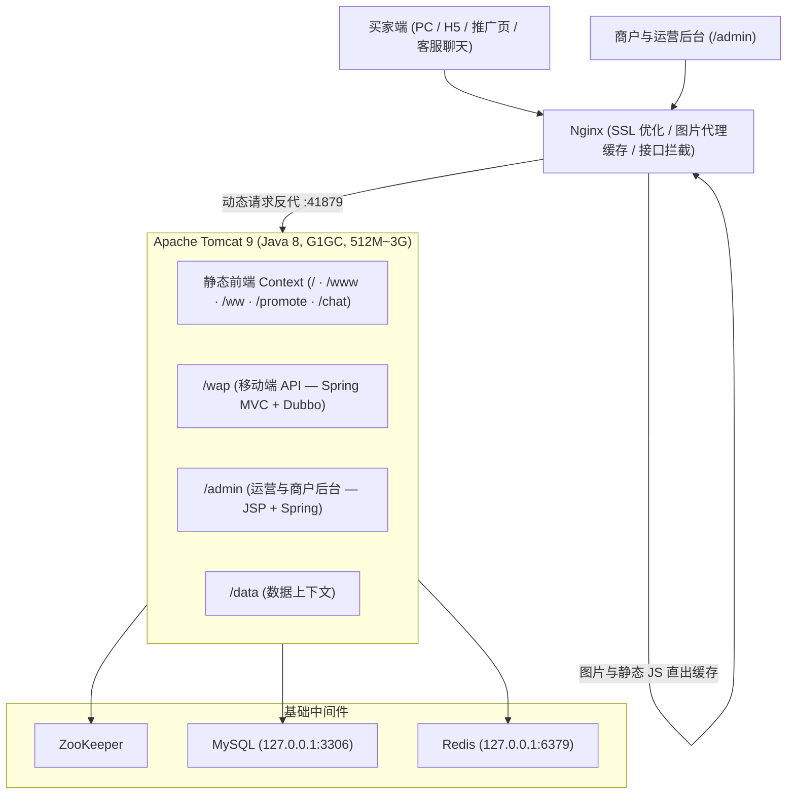

# TGShop 跨境商城

> 更新日期：2026-11-23 · [返回主页](https://github.com/leee991)

这是一套偏传统的 Java 商城系统（Java 8 + Tomcat 9 + Spring + Dubbo + ZooKeeper + MySQL + Redis）。接手后主要做了迁移部署、Nginx 静态/图片缓存拆分、JVM 参数调优和线上防刷止血。

## 整体结构

## 重点做过哪些调优和治理

1. **把静态文件和图片从 Tomcat 里剥出来**
   - 原来大量商品图、商户头像和前端 JS 都打到 Tomcat，线程和内存吃得很紧。
   - 改完后 `/images/`、`/avatar/`、`/merchant/`、`/shopAvatar/` 等十几个图片路径全部走 Nginx `alias` 直出，加了 `expires 30d; Cache-Control: public, max-age=2592000, immutable` 并关掉静态 access log；带 hash 的 JS 也走长缓存。
   - 历史迁移遗留的外站图片路径用 Nginx 反代加本地缓存区兜底，响应头带 `X-Image-Cache` 方便看命中率。
2. **线上被刷接口直接用 Nginx 止血**
   - 几个评价统计接口（`evaluation!countType.action`）经常被刷高 CPU，直接加了 Nginx 规则拦掉返回 403 JSON，不用改 Java 代码重启 Tomcat；顺手把几个历史残留诊断 JSP 路径也屏蔽成 404。
3. **Tomcat 和 JVM 生产加固**
   - 启动参数配了 `-Xms512m -Xmx3072m -XX:+UseG1GC`、强制加上 `-Dfastjson.parser.safeMode=true` 堵住 Fastjson 反序列化漏洞、`UMASK=0027` 收紧文件权限。

## 目录说明

- `docs/ARCHITECTURE.md`：Tomcat 11 个 Context 分布、Spring/Dubbo 模块清单与调优记录
- `docs/API_CONTRACT.md`：Nginx 分流策略与后台功能模块
- `config/`：整理后的 Nginx 配置、Tomcat `server.xml` / `context.xml` 和 `Dockerfile`
- `skeleton/spring-dubbo-wiring.md`：从 Spring XML 抽取出来的 Bean 和 Dubbo 接口装配清单
- `DIRECTORY_TREE.txt`：目录结构统计
